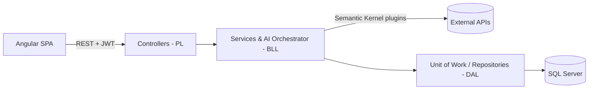

# ✈️ Vantio — AI Travel Planner (Backend API)

**Vantio** plans a full trip for you: tell it where you want to go, your dates and your budget, and it builds a **day-by-day itinerary** with flights, hotels, places to visit and the weather — all inside your budget.

This repository is the **ASP.NET Core Web API** behind it. Graduation project of the **ITI Full-Stack .NET & Generative AI** track (2026), built by a 5-person team.

🌐 **Live demo:** [frontend-smart-travel-planers.vercel.app](https://frontend-smart-travel-planers.vercel.app/)
🖥️ **Frontend (Angular):** [Vantio-Frontend](https://github.com/Mohamed-Elhosinii/Vantio-Frontend)

---

## ✨ Features
- 🤖 **AI trip planner** — Microsoft **Semantic Kernel** + **GPT-4o-mini** build a personalized plan, calling our own services (flights, hotels, weather, places) as **plugins**
- 💰 **Budget-aware planning** — the budget is split between flights, hotel and activities and validated before the plan is returned
- 🔐 **Authentication** — ASP.NET Core Identity, **JWT** access + refresh tokens, **Google login**, email OTP verification, password reset
- 💳 **Subscriptions & payments** — **Paymob** gateway with webhook handling, plan usage limits
- 📊 **Admin dashboard API** — users, plans, payments and statistics
- 🛡️ **Production basics** — global exception middleware, FluentValidation, rate limiting on auth endpoints, background jobs (expired subscriptions, old tokens)
- ✅ **200+ xUnit tests**

## 🔌 External APIs
| Data | Provider |
|---|---|
| Flights | AirLabs / Aero |
| Hotels | StayAPI |
| Places & attractions | Foursquare |
| Weather | Visual Crossing |
| AI model | GitHub Models (GPT-4o-mini) |
| Payments | Paymob |

## 🏗️ Architecture
3-Tier architecture with **Repository** and **Unit of Work** patterns:

```
SmartTravelPlaners.PL    → Controllers, middleware, Program.cs (API layer)
SmartTravelPlaners.BLL   → Business logic, feature services, AI orchestrator, DTOs, validation
SmartTravelPlaners.DAL   → EF Core DbContext, entities, Fluent API configurations, repositories, migrations
SmartTravelPlaners.Tests → xUnit tests
```



## 🛠️ Tech stack
**.NET 10** · ASP.NET Core Web API · Entity Framework Core · SQL Server · ASP.NET Core Identity · JWT · Semantic Kernel · FluentValidation · xUnit · Swagger

## ▶️ Run it locally
**Requirements:** .NET 10 SDK, SQL Server (LocalDB or Developer), Visual Studio 2022+ or Rider

```bash
git clone https://github.com/Mohamed-Elhosinii/Vantio-Backend.git
cd Vantio-Backend/SmartTravelPlaners.PL
```

Add your settings with **User Secrets** (keeps keys out of the code):
```bash
dotnet user-secrets init
dotnet user-secrets set "ConnectionStrings:DefaultConnection" "Server=.;Database=VantioDB;Trusted_Connection=True;TrustServerCertificate=True"
dotnet user-secrets set "JwtSettings:Key" "<a long random secret>"
# Also needed: Authentication:Google, EmailSettings, Paymob, GitHubModels,
# HotelApiSettings, WeatherApiSettings, FoursquareSettings, SerperSettings
```

Create the database and run:
```bash
dotnet ef database update --project ../SmartTravelPlaners.DAL
dotnet run
```
Then open **Swagger** at `https://localhost:<port>/swagger`.

## 👥 Team
| Member | GitHub |
|---|---|
| Mohamed Mostafa Elhoseny | [@Mohamed-Elhosinii](https://github.com/Mohamed-Elhosinii) |
| Hesham Diab | [@Heshamdiab2003](https://github.com/Heshamdiab2003) |
| Nourin Reda | — |
| Mariam Mostafa | — |
| Basma HossamElDin | — |

**My part:** set up the 3-tier solution, the Generic Repository & Unit of Work, EF Core Fluent API configurations, the Hotel and Weather API integrations (as Semantic Kernel plugins), work on the Trip Orchestrator (budget split, round-trip flights), and moving API keys out of the code into configuration.

Mentors: Mazen Barakat, Alyaa Khaled — ITI.
